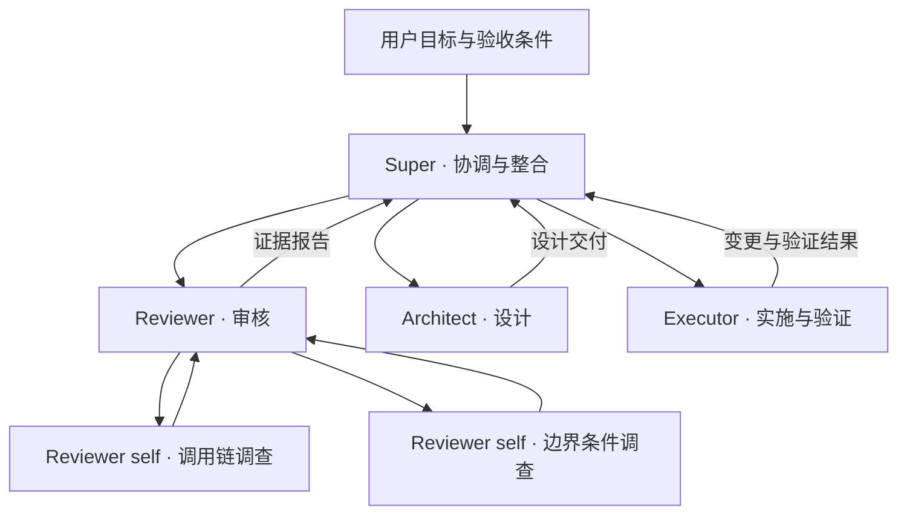
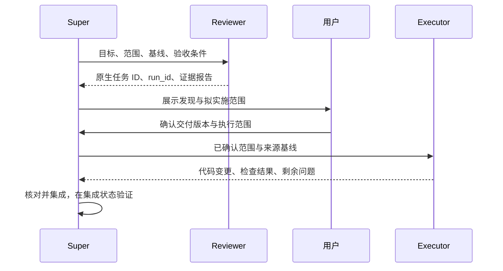

## 1. 从单 Agent 基线开始

单 Agent 可以连续完成定位、修改、验证。它保留完整任务背景，适合步骤相互依赖、修改集中在少量文件的工作。增加 Agent 后，还要付出任务说明、重复读取、等待、汇总和集成的成本。

判断是否拆分，先找已经出现的瓶颈，再选择对应机制。

| 观察到的问题 | 优先尝试 | 适用边界 |
|---|---|---|
| 小功能需要连续理解和修改 | Super 独立完成 | 保留上下文连续性 |
| 审核时经常误用写入工具 | 独立 Reviewer，绑定只读工具 | 用运行时权限约束角色 |
| 设计复杂，实现范围明确 | Architect 设计，确认后交 Executor | 交付契约足够清楚 |
| 审核范围大，搜索输出挤占主上下文 | Reviewer 创建同角色分身 | 按调用链或风险类别分片 |
| 多项独立功能耗时长 | 各任务使用独立 worktree | 接口稳定，可分别验证再集成 |
| 同一接口反复调整，任务频繁互相等待 | 收回一个 Agent 连续处理 | 协调成本已经抵消并行收益 |

粗略估算并行时间可用下面的关系。只有独立部分能重叠，交接和集成仍占用时间。

```text
单 Agent 时间 ≈ A + B + 验证
并行时间     ≈ max(A, B) + 委派 + 汇总 + 集成验证
总费用       = 所有 Agent 的模型调用 + 重复上下文 + 失败重试
```

父 Agent 的上下文缩短，也可能伴随总 Token 增加。先保持工具、任务、验收条件与总预算可比，再测完成率、耗时和费用。

## 2. 区分角色、分身与并行

| 维度 | 回答的问题 | coder-cli 的约定 |
|---|---|---|
| Role agent | 哪类能力负责此任务？ | Super、Reviewer、Architect、Executor |
| Sub-agent | 谁委派，谁汇总？ | `self` 创建当前角色的新运行 |
| 并行 | 哪些工作可以同时推进？ | 按任务依赖与工作区边界决定 |

框架中的 SubAgent 可以包装不同角色。coder-cli 在此之上规定，跨角色委派统一经过 Super，专业角色只能调用自己的分身。Reviewer 拆出的调查仍由 Reviewer 完成，复用只读能力。



中心调度使用户目标和最终决策集中在 Super。专业角色仅接收完成任务所需的信息，调查过程保留在各自历史中。Super 仍须核对报告与原目标，角色划分只能减少路由空间，无法自动消除误派任务。

## 3. 用 Pydantic AI 运行

Pydantic AI 支持工具委派、程序化 hand-off 和图编排。工具委派结束后，父 Agent 继续运行。程序化 hand-off 由应用或人决定下一个 Agent。coder-cli 使用原生委派机制交付任务，业务上再把已审核产物交给下一角色。[官方多 Agent 指南](https://pydantic.dev/docs/ai/guides/multi-agent-applications/)

| 能力 | 原生接口 | 应用需要补充的规则 |
|---|---|---|
| 命名角色与同角色分身 | `SubAgent`、`SubAgents(include_self=True)` | 角色指令、工具与跨角色路由限制 |
| 后台执行与任务控制 | `TaskControl`、`DelegationTasks` | 任务所属会话、生命周期与资源清理 |
| 查询、补充、恢复、取消 | `list_tasks`、`message_task`、`delegate_task(resume=...)`、`cancel_task` | 恢复前检查工作区与副作用 |
| 交付与报告 | 原生任务记录、`DelegationReports` | 报告进入 Super 的时机、人工确认 |
| 不同工作目录 | `workspace_resolver` | worktree 创建、基线校验与集成 |
| 预算边界 | `UsageLimits`、`max_depth`、任务并发限制 | 校准预算并汇总实际费用 |

`conversation_id` 表示会话，`run_id` 表示一次运行，术语沿用 Pydantic AI。原生任务 ID 用于查询、续作与引用交付，任务恢复后的 `run_id` 可以变化。持久化交付来源应同时保留任务 ID 和来源 `run_id`。[原生委派与会话示例](https://pydantic.dev/docs/ai/harness/subagents/#managed-delegation-sessions)

后台任务需要跨越 Super 的多次运行。coder-cli 在会话生命周期内保持 `DelegationTasks.opened()`，每次运行通过 `bind()` 接入同一个任务所有者。原生任务记录保存到磁盘，运行快照保留请求与工具进度。进程重启后，未完成任务按中断状态处理，检查副作用后再显式续作。

阅读实现时，可从角色构建进入委派和权限边界，再追踪工作区分配与会话运行。[角色构建](../coder-cli/agent/runtime.py)、[委派策略](../coder-cli/agent/delegation.py)、[角色运行能力](../coder-cli/agent/role_services.py)、[工作区分配](../coder-cli/storage/worktrees.py)、[会话运行](../coder-cli/agent/conversation.py)

### 3.1 用能力组合形成角色边界

下面抽取 coder-cli 的构建方式。`model` 由模型工厂提供，工作区、持久化和应用权限由外围运行环境绑定。

```python
from pydantic_ai import Agent, UsageLimits
from pydantic_ai_harness.filesystem import FileSystem
from pydantic_ai_harness.subagents import SubAgent, SubAgents, TaskControl

reviewer = Agent(
    model,
    name="reviewer",
    instructions="审核指定范围，返回位置、证据、影响和未验证项。",
    capabilities=[
        FileSystem(read_only=True, tools=("read_file", "list_files", "grep")),
        SubAgents(
            include_self=True,
            max_depth=3,
            task_control=TaskControl(max_running_tasks=4),
        ),
    ],
)
review_delegate = SubAgent(
    reviewer,
    name="reviewer",
    read_only=True,
    usage_limits=UsageLimits(request_limit=50),
)
```

Super 的构建中把 `review_delegate` 放入 `SubAgents(agents=[...])`，并通过 `workspace_resolver` 选择目录。命名角色使用自己的工具，`self` 保留当前 Agent 绑定的指令和能力。两者都使用独立消息历史，委派文本须自包含。任意自定义 Python 工具还需自行约束副作用，只读文件能力无法限制绕过工作区接口的代码。[Harness SubAgents](https://pydantic.dev/docs/ai/harness/subagents/)

### 3.2 模型和权限分别绑定

coder-cli 用 `Role.model_tier` 绑定 `ModelTier` 枚举，再从 `provider.jsonc` 的 `model_tiers` 解析模型键。模型条目决定 provider、协议和上下文窗口，凭据与完整服务地址从环境读取。角色代码保持稳定，模型映射可以独立调整。

| 角色 | 当前模型档位 | 工具职责 |
|---|---|---|
| Super | Medium | 综合工具、委派与最终整合 |
| Reviewer | Medium | 读取、搜索、查看 diff，交付审核证据 |
| Architect | High | 只读分析，交付架构与实施步骤 |
| Executor | Low | 文件读写、命令执行与增量验证 |

Super 与 Executor 使用相同的工具权限规则，执行仍受沙箱、受保护路径和显式规则约束。Reviewer 与 Architect 受只读限制。角色可分别绑定 Skills 和工具白名单，避免所有任务都面对相同的能力集合。档位是起始配置，应依据任务评测调整。

## 4. 用 Reviewer 串起调查、交付与实施

假设任务是审核平均值函数的空输入处理。先让 Reviewer 读取实现和调用方，必要时把两个独立问题交给同角色分身。

```text
父任务
审核 average 的空输入处理，范围限 src/stats.py 及直接调用方。
基线为提交 <sha>，输出可复现问题和未验证项，保持只读。

分身 A
读取 average 的实现，检查空序列、生成器和异常行为，返回代码位置。

分身 B
检查直接调用方如何处理异常，返回受影响路径和证据。
```

分片按问题划分，能减少重复调查。Reviewer 汇总时回查证据，区分“代码可以推导”与“已经运行验证”。同一模型的多个分身可能重复相同误判，结论数量不能代替测试。

交付采用简短契约，放入原生任务输出即可。

```text
目标       average([]) 应按约定抛出 ValueError
范围       src/stats.py 与直接调用方
基线       提交 <sha>，工作目录 <path>
证据       文件位置、触发条件、当前行为
建议       最小修改与受影响调用方
验证       已执行检查、预期结果、未验证项
来源       原生任务 ID 与来源 run_id
```

用户确认交付后，Super 才把明确范围交给 Executor。Executor 完成实现和相关检查，再由 Super 审查、整合。直接指派的实现任务已有用户授权，引用设计或审核报告实施时需要确认对应交付版本。报告内容作为待核对证据处理。



## 5. 并行需要同时管理代码与消息

### 5.1 worktree 固定代码基线

coder-cli 从 Git 仓库根目录派发独立角色任务时，以指定提交创建 detached worktree，默认基线是 `HEAD`。主工作区未提交的修改不会自动进入新任务。普通目录和仓库子目录复用当前目录，通过工具级工作区锁控制冲突。

| 场景 | 工作区安排 | 一致性边界 |
|---|---|---|
| 同角色只读分身 | 共享父任务目录 | 可并行读取，目录仍可能被外部程序修改 |
| 同角色写入分身 | 共享父任务目录，串行执行 | 避免父子同时写入 |
| 独立角色任务 | 仓库根目录下创建独立 worktree | 各自基于明确提交推进 |
| 普通目录任务 | 共享当前目录 | 每次冲突操作单独处理 |

其他任务完成修改后，已有 worktree 继续保留原基线。同步代码需要明确提交、合并或重新派发。来源 worktree 的交接要求先建立干净的提交检查点，下一任务才能以该提交为基线。合入后重新验证接口和行为。

worktree 隔离文件变更，但各任务仍可能共享端口、数据库、外部服务与 Git 元数据。为测试分配独立端口和临时数据，避免把目录隔离理解为进程沙箱。

### 5.2 会话锁与工作区锁各管一件事

| 锁 | 获取时机 | 保护对象 |
|---|---|---|
| 会话锁 | 一次 run 入口 | 同一 `conversation_id` 的历史和快照 |
| 工作区共享锁 | 实际读取工具执行时 | 允许并行读，避开重叠目录的写操作 |
| 工作区独占锁 | 文件写入或 Shell 工具执行时 | 防止重叠目录的读写冲突 |

Executor 写文件期间，Super 可以处理天气等无关请求。Super 随后调用冲突的文件工具时，该工具返回忙碌错误。项目概览可暂用缓存，工作区记忆暂缓加载。模型推理期间不长期占用工作区锁。

工具级锁只保护参与该协议的操作。多次读取之间，文件仍可能改变，关键审核应记录提交基线并在应用前重新核对。Shell 后台进程脱离工具调用后也可能继续修改文件，需要任务自行管理进程生命周期。

### 5.3 后台结果进入新的 Super run

前台委派直接返回发起调用的 run。独立后台任务保留自己的任务记录与历史，成功、失败和取消都由 Super 回应。

```text
Super run A 正在处理用户请求
    └─ 后台任务 T 完成 → 记录待交付结果
Super run A 结束
Super run B 读取 T 的任务 ID、来源 run_id 和报告 → 回应结果
```

把结果推入正在执行的 run，可能让旧任务错误混入新问题。按交付版本启动新 run，可以保留来源并避免中途改变当前请求的目标。恢复任务时仍需检查已发生的文件或外部副作用，取消和失败都可能留下部分成果。

## 6. 与成熟 Coding Agent 对照

| 系统 | 组织方式 | 可借鉴的取舍 |
|---|---|---|
| Claude Code | 专项 subagent 可配置模型、工具、权限、Skills，支持独立上下文及 worktree 隔离 | 把角色配置与运行隔离分别落实 |
| Pi | 核心保持单 Agent，sub-agent 通过扩展、包或外部进程组织 | 让复杂协作按实际需求引入 |
| coder-cli | Super 中心调度，固定专业角色，同角色 `self` 分身 | 限定路由关系，复用原生任务控制与报告 |

这些实现体现了不同的产品取舍。角色数与并行数应服务于任务结构，工具权限和验收规则仍需单独设计。[Claude Code subagents](https://code.claude.com/docs/en/sub-agents)、[Pi 官方说明](https://github.com/earendil-works/pi/tree/main/packages/coding-agent)

## 7. 用实验决定是否保留多 Agent

选择同一组审核任务，固定代码提交、验收标准和总预算，比较三种方式。

| 实验 | 运行方式 | 重点观察 |
|---|---|---|
| A | Super 独立审核、修复、验证 | 强单 Agent 基线 |
| B | Reviewer 审核，确认后 Executor 实施 | 角色分工的质量与交接成本 |
| C | Reviewer 加两个只读分身，再交 Executor | 调查覆盖与并行时间收益 |

记录可复现缺陷数、误报数、集成后通过率、总耗时、总费用、重复读取和人工纠正次数。统一使用同一模型再比较一次，可以区分编排收益与模型差异。全部角色的费用都应计入。

练习中故意加入三种变化，观察系统如何应对。

1. 委派后修改主工作区，确认独立 worktree 仍使用原基线，报告能识别版本差异。
2. 在后台 Executor 写入期间发送无关请求，随后尝试冲突的工作区操作，比较两者行为。
3. 取消任务后恢复，核对部分文件变更、任务 ID、来源 run_id 与实际检查结果。

coder-cli 提供角色约束、独立上下文、任务控制和工作区隔离，这些机制创造了专业化与并行的条件。具体任务能否更快、更省或更准确，仍需通过上述对照实验判断。
