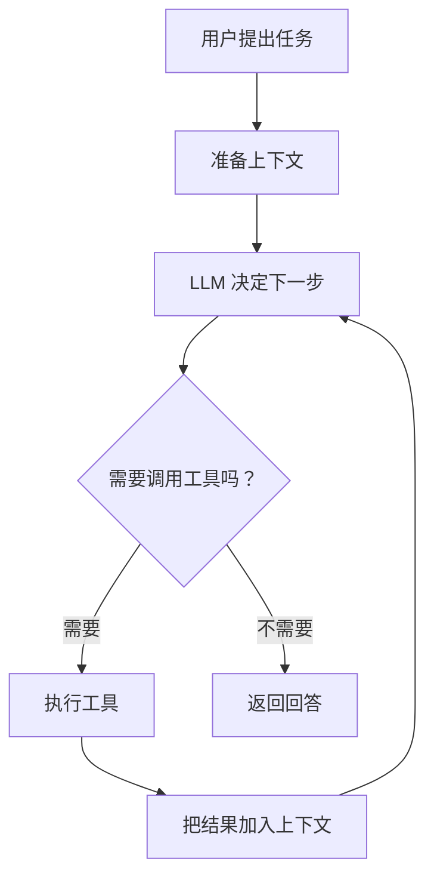
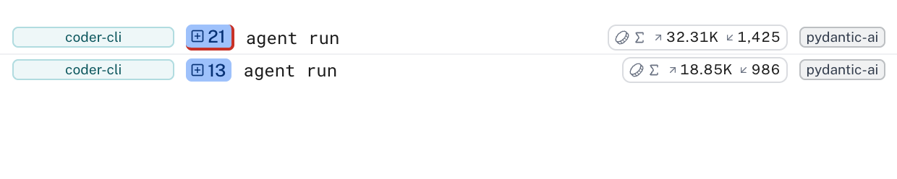

## 1. Agent 的本质

> Agent 是能围绕目标，自己决定下一步并动手执行的 AI 系统。

比如让 AI“修复这个报错”：普通对话可能给你一段修改建议；Coding Agent 可以自己读代码、修改文件、运行测试，再根据结果继续修改。

### Agent 的组成

可以先用一个公式来理解：

> Agent = LLM + Tools + Working Memory + Autonomy + Guardrails

- **LLM（大语言模型）**：理解任务，决定下一步做什么。
- **Tools（工具）**：让模型能动手，比如读文件、搜索代码、执行命令。
- **Working Memory（工作记忆）**：模型当前能参考的信息，比如对话、代码和工具结果。它们放在上下文中，context window 决定一次最多能装多少。
- **Autonomy（自主决策）**：根据当前情况自己选择下一步，而不是每一步都由人指定。
- **Guardrails（护栏）**：给执行划定边界，比如最多运行多少步、哪些操作需要用户确认。

用户输入 query 后，程序把任务说明、对话历史等信息组装成上下文，交给 LLM。LLM 决定直接回答，还是调用工具；需要工具时，程序在护栏允许的范围内执行，再把结果放回上下文，让 LLM 继续判断。这样循环，直到返回最终回答，或触发停止条件。

### Agent 的自主程度

关键看：**下一步由谁决定？**

- **Workflow（工作流）**：程序提前安排好步骤，按流程执行。
- **Agent**：模型根据任务和执行结果，动态决定下一步。

两者可以结合。例如修复代码时由 Agent 自己探索，发布时按固定流程审批。不能只看用了什么框架、有没有规划、几个 Agent，就判断自主程度。

## 2. Agent Loop

Agent 通常不是调用一次模型就结束，而是反复执行：**做决定 → 调用工具 → 查看结果 → 再做决定**。这个循环就是 Agent Loop。



以“修复失败的测试”为例：

1. 模型决定先运行测试，查看报错。
2. 根据报错读取相关代码。
3. 修改代码，再运行测试。
4. 如果仍然失败，就根据新的报错继续修改；通过后向用户说明结果。

**模型负责决定调用什么工具，程序负责真正执行工具，再把结果交回模型。**

实际运行还需要停止条件：任务结束、用户取消、达到步数或费用上限，或者遇到无法继续的错误。需要用户确认时，也可以先暂停。

模型说“完成了”不代表一定做对了。修复代码后，仍要查看测试结果和实际改动。

### 不同的决策方法

**Agent Loop 是程序的执行循环，决策方法决定模型在循环里怎么推进任务。** 下面这些方法可以组合使用，不是自主程度的等级。

**ReAct：推理 → 行动 → 观察 → 再次推理。**

根据当前上下文推理，选择并调用可用工具，观察工具返回的结果，再决定下一步。重点是边行动、边根据反馈调整，不要求先制定完整计划。模型选择工具，程序实际执行工具。

**Plan-and-Execute：制定计划 → 逐步执行 → 根据结果更新计划。**

先把目标拆成步骤，再按计划推进。每一步的结果和当前进度都会放回上下文，帮助模型判断是继续下一步，还是修改计划。执行某个步骤时，也可以使用 ReAct。

**反思修正（Reflection）：产出结果 → 检查问题 → 修正结果 → 再次检查。**

先完成一次尝试，再结合检查意见或测试结果，判断哪里需要改进，把这些反馈放回上下文后重新尝试。重点是根据反馈修正结果；模型认为改好了，仍需要验证。

**搜索式决策：提出多个候选 → 评估比较 → 选择分支继续探索。**

面对多种可能的下一步，先比较不同选择，再沿更有希望的方向推进；走不通时，可以退回去尝试其他分支。重点是探索和比较多条路径，不只是沿一条路径不断执行。

**路由选择（Routing）：判断任务 → 选择处理方式 → 交给对应流程或 Agent。**

先根据当前上下文判断该由谁处理、走哪条路径，再把任务交过去。它主要解决“交给谁、走哪条路”，后续处理仍可以使用以上方法。

ReAct 的“推理、行动、观察”和 Loop 的“调用模型、执行工具、返回结果”很容易对应，所以经常被混用。但 Agent Loop 也能用来制定和更新计划、检查和修正结果，不只承载 ReAct。

延伸阅读：[ReAct](https://arxiv.org/abs/2210.03629)、[Plan-and-Execute](https://www.langchain.com/blog/planning-agents)、[搜索式决策（Tree of Thoughts）](https://arxiv.org/abs/2305.10601)、[路由与评估修正](https://www.anthropic.com/research/building-effective-agents)。


## 3. 实战 Pydantic AI

这一节直接使用官方 Harness 的 `Coder`，让 Agent 创建一个 Python 项目，再运行它输出 `hello world`。文件读写、代码搜索和命令执行都由 Coder 提供。

### 3.1 Coding Agent

#### 第一步：准备项目

需要安装 [uv](https://docs.astral.sh/uv/getting-started/installation/)。从零开始时运行：

```bash
uv init coder-cli --python 3.13
cd coder-cli
uv add 'pydantic-ai-harness[coder]' 'pydantic-ai-slim[openai]' 'httpx[socks]' python-dotenv logfire
```

如果使用本课程已有的 `coder-cli`，进入项目后运行 `uv sync --locked` 即可，跳过初始化。

如果遇到 `ImportError: Using SOCKS proxy, but the 'socksio' package is not installed`，说明正在使用 SOCKS 代理，但缺少它的可选依赖。在项目目录运行：

```bash
uv add 'httpx[socks]'
```

它会安装 `socksio`，并更新项目依赖和锁文件。上面的安装命令已包含它。使用 pip 时，对应命令是 `python -m pip install 'httpx[socks]'`；引号可以避免 zsh 把方括号当成文件匹配。参见 [HTTPX 的 SOCKS 说明](https://www.python-httpx.org/advanced/proxies/#socks)。

在项目根目录创建 `.env`，填写支持工具调用的 OpenAI 兼容接口：

```dotenv
OPENAI_BASE_URL=https://your-provider.example/v1
OPENAI_API_KEY=你的密钥
AGENT_MODEL=你的模型名称
```

#### 第二步：接入 Coder

把下面代码放到 `main.py`。这是第一章的单次执行教学版本；当前仓库已在[第五章](./05-harness.md)演进为 TUI，Agent 装配位于 `agent_runtime.py`，入口不再接收 prompt 参数。

```python
import argparse
import os
from pathlib import Path

import logfire
from dotenv import load_dotenv
from pydantic_ai import Agent, UsageLimits
from pydantic_ai.capabilities import LocalWorkspace
from pydantic_ai.models.openai import OpenAIChatModel
from pydantic_ai.providers.openai import OpenAIProvider
from pydantic_ai_harness.coder import Coder


def main() -> None:
    parser = argparse.ArgumentParser(description="用自然语言创建一个 Python 小项目")
    parser.add_argument("prompt", help="让 Agent 完成的任务")
    args = parser.parse_args()
    load_dotenv()
    logfire.configure(service_name="coder-cli", send_to_logfire="if-token-present")
    logfire.instrument_pydantic_ai()
    model_name = os.getenv("AGENT_MODEL")
    if not all((model_name, os.getenv("OPENAI_BASE_URL"), os.getenv("OPENAI_API_KEY"))):
        parser.error("请在 .env 配置 OPENAI_BASE_URL、OPENAI_API_KEY 和 AGENT_MODEL（兼容 AGENT_MODAL）。")
    workspace = Path("workspace").resolve()
    workspace.mkdir(exist_ok=True)
    model = OpenAIChatModel(
        model_name,
        provider=OpenAIProvider(
            base_url=os.environ["OPENAI_BASE_URL"], api_key=os.environ["OPENAI_API_KEY"]
        ),
    )
    agent = Agent(
        model,
        capabilities=[LocalWorkspace(workspace), Coder()],
        instructions=(
            "实际创建并运行代码，验证输出后用中文说明结果；不要修改任务无关的文件。"
            "写文件前，先通过工具确认父目录存在；不存在时先用 shell 的 mkdir -p 创建。"
            "收到目录创建成功的结果后，才能调用 write_file；不能在同一批调用中创建目录并写入其中的文件。"
            "父目录就绪后，不同文件的独立写入可以并行。"
        ),
    )
    try:
        result = agent.run_sync(
            args.prompt,
            usage_limits=UsageLimits(request_limit=10),
            model_settings={"timeout": 30},
        )
    except Exception as exc:
        message = str(exc)
        for name in ("OPENAI_API_KEY", "LOGFIRE_TOKEN"):
            if token := os.getenv(name):
                message = message.replace(token, "***")
        parser.exit(1, f"任务未完成（{type(exc).__name__}）：\n{message}\n")
    print(result.output)


if __name__ == "__main__":
    main()
```

直接运行根目录的 `main.py`，不需要创建 Python 包或配置命令入口。

请求失败时，终端会显示异常类型和具体错误内容，方便检查接口返回的原因；如果错误中包含当前配置的 API Key，会先隐藏密钥。

这里主要看三个部分：

- `OpenAIChatModel`：通过配置好的兼容接口调用模型。
- `LocalWorkspace(workspace)`：指定文件相对路径和命令的起始目录。
- `Coder()`：提供文件读写、搜索和 Shell 等编码能力，不需要自己定义工具。

`LocalWorkspace` 在本机执行，不是沙箱，也不会把所有操作限制在这个目录里。本节只在独立的练习目录运行可信任务。

#### 第三步：运行

在 `coder-cli` 项目根目录运行：

```bash
uv run python main.py
# 在 TUI 输入区发送：
# 在 hello 目录初始化一个无第三方依赖的 Python 项目，创建 pyproject.toml、README.md 和 main.py。main.py 运行时只输出 hello world。读取 main.py，再运行它确认结果。
```

Agent 会使用 Coder 自带的工具创建目录、写入文件、读取代码并执行命令。具体调用顺序由模型决定，程序最后打印模型的完成说明。预期生成：

```text
workspace/
└── hello/
    ├── pyproject.toml
    ├── README.md
    └── main.py
```

亲自运行生成的程序，检查结果：

```bash
uv run python workspace/hello/main.py
```

预期输出：

```text
hello world
```

再次练习时，建议把任务里的 `hello` 换成新目录名，方便对照结果。如果调用返回 404，先检查 API 地址和模型名称；模型返回“完成”后，也要检查实际文件与运行结果。

### 3.2 用 Logfire 观测

#### 配置 Logfire，查看执行过程

只看最后一句“完成了”，很难知道 Agent 中间做了什么。Logfire 可以把一次运行展开，看到每次模型请求和工具调用。

**1. 启用观测。** 前面的依赖安装已经包含 `logfire`。在 `load_dotenv()` 后、创建 Agent 前加上这两行；本节完整代码已包含，不用重复添加：

```python
logfire.configure(service_name="coder-cli", send_to_logfire="if-token-present")
logfire.instrument_pydantic_ai()
```

第一行配置观测，第二行接入 Pydantic AI，自动记录模型和工具调用。`service_name` 是应用名称，数据发到哪个项目由项目凭据决定。

**2. 连接 Logfire 项目。** 在 [Logfire](https://logfire.pydantic.dev/) 创建或选择项目，取得该项目的 Write Token，填入 `.env`：

```dotenv
LOGFIRE_TOKEN=你的项目写入Token
```

也可以用配置向导连接项目，把组织名和项目名换成自己的：

```bash
uvx logfire-cli --region=us --org '你的组织名' wizard --project '你的项目名' --task 'instrumentation'
```

先确认项目存在，再按提示登录授权，核对连接的项目。Token 放在 `.env`，本地项目凭据保存在 `.logfire/` 时，两者都不要提交到 Git，本项目已加入忽略规则。

**3. 重新运行任务。** 在对应项目的 Live 页面找到这次运行，展开模型请求和 `Called write_file` 等工具调用：

- **Request**：模型传了哪些参数，比如文件路径和内容。
- **Result**：工具实际返回什么，是成功结果还是失败原因。
- **耗时和 token 用量**：时间花在哪里，模型调用消耗多少 token。

配置项目凭据后，任务、模型回复和工具内容会随追踪发送到 Logfire。没有 Token 或本地项目凭据时，只做本地观测。费用只有在模型定价能被识别时才显示；兼容接口里的 GLM 模型可能无法匹配价格，以服务商账单为准。参见 [官方观测说明](https://pydantic.dev/docs/ai/integrations/logfire/)。

#### 从一次失败中优化 Agent

这次运行中，模型并行调用了三次 `write_file`，准备创建项目文件。但展开 Result 后发现，它们都返回了同一个问题：

```text
Parent directory 'hello' does not exist. Create the parent directory first.
```


Request 里的路径是 `hello/README.md`，但模型还没有创建 `hello` 目录。Coder 的 `write_file` 不会自动创建父目录，所以三个写入都失败了。即使改成依次写入，目录不存在也一样会失败。

**缺少的是前置步骤：先确认目录存在，再写文件。** 已在 `agent_runtime.py` 的 `instructions` 中补充：

- 写文件前，通过工具确认父目录存在。
- 不存在时，先用 `shell` 执行 `mkdir -p`。
- 收到创建成功的结果后，再调用 `write_file`。
- 目录就绪后，不同文件的独立写入可以并行。

没有新增工具，继续使用官方 Coder。调整的是模型执行任务的顺序：有依赖的操作先后执行，互不依赖的操作再并行。

离线测试已验证“先创建目录，再批量写入三个文件，最后运行 Python”的流程。接着用真实模型重新运行，在 Logfire 中比较两次记录。

### 3.3 理解 Loop 与 Token 费用

#### 对比两次运行：步骤、Token 和费用

下图上面是优化前，下面是优化后：



| 指标 | 优化前 | 优化后 |
| --- | ---: | ---: |
| Step 数 | 21 | 13 |
| 输入 token | 约 32.31K | 约 18.85K |
| 输出 token | 1,425 | 986 |
| 输入与输出合计 | 约 33.74K | 约 19.84K |

这次 step 从 **21 减少到 13**，少了 8 步；输入 token 减少约 **42%**，输出 token 减少约 **31%**，合计减少约 **41%**。K 表示千，截图中的数值经过取整，所以这里也是近似计算。

这里顺势区分三个概念：

- **Turn（一轮交互）**：用户提出一次任务，到 Agent 返回回答。两次运行各完成一个 turn。
- **Step（执行步）**：这里按 Logfire 追踪中的执行条目统计，包括模型请求和工具执行。一个 turn 可以有多个 step。
- **Token（词元）**：模型处理内容的计量单位。输入包括指令、工具说明、对话和工具结果；输出包括模型生成的回复和工具调用参数。

本节统一按这个口径比较 step 数。13 个 step 不等于调用模型 13 次，因为其中还包含工具执行。代码中的 `request_limit=10` 限制的是模型请求次数，不是这里的 step 总数。

为什么少走几步，token 也会减少？因为 Agent 每次再次调用模型，都要带上所需的上下文。一次失败的写入不仅产生错误结果，还可能让模型多判断一次、补建目录、重新写入；这些内容又会进入后续调用的输入。先把依赖顺序安排好，就能减少这类无效往返。

这里的输入用量是整次运行中多次模型请求的累计值，不是单次 context window 的长度。并行写文件也不等于只算一次工具调用；减少的是不必要的等待、失败和后续模型请求。

#### Token 怎样对应 Cost？

模型通常对输入和输出分别计价。如果服务商的单价单位是“元 / 百万 token”，基础计算是：

```text
费用 = 输入 token ÷ 1,000,000 × 输入单价
     + 输出 token ÷ 1,000,000 × 输出单价
```

用这两次记录代入：

```text
优化前 ≈ 32,310 ÷ 1,000,000 × 输入单价 + 1,425 ÷ 1,000,000 × 输出单价
优化后 ≈ 18,850 ÷ 1,000,000 × 输入单价 +   986 ÷ 1,000,000 × 输出单价
```

输入和输出的单价可能不同，所以 **token 合计减少 41%，不代表费用也恰好减少 41%**。如果服务商区分缓存命中和未命中的价格，还要把对应 token 分开计算。Logfire 有匹配的定价时可以估算费用，最终以当前服务商的计费规则和账单为准。

这次对比说明：先通过追踪找到多余动作，再调整执行顺序，可以减少无效调用和 token 消耗。但两次运行还不能证明每次都能节省相同比例；比较时也要确认任务、模型、初始目录和完成质量一致。

#### Loop 在哪里？

代码没有手写 `while`，因为 `agent.run_sync()` 已经负责循环：

1. 把任务、指令和工具说明交给模型。
2. 模型选择工具，由 Coder 执行文件操作或命令。
3. 工具结果进入上下文，再交给模型决定下一步。
4. 重复以上过程，直到模型返回最终回答，或达到 10 次模型请求上限。

任务和工具结果是这次运行的工作记忆；模型自己选择下一步体现自主决策。先跑通这个循环，后续再补权限、会话保存和 Web GUI。

参考：[官方 Coder 文档](https://pydantic.dev/docs/ai/harness/coder/)、[OpenAI 兼容接口配置](https://pydantic.dev/docs/ai/models/openai/)。

#### 把术语对应到代码

| 术语 | 通用解释 | 在这份代码里怎么看 |
| --- | --- | --- |
| **Turn（一轮交互）** | 从用户提出一次请求，到系统返回回答。一轮交互可以包含多个执行步骤。 | `args.prompt` 接收任务，`agent.run_sync()` 执行，最后 `print(result.output)` 返回回答，组成这一轮交互。 |
| **Step（执行步）** | 任务执行过程中的一个步骤。不同框架的计数方式可能不同，需要先明确统计口径。 | 本节按 Logfire 记录的执行条目统计，包含模型请求和工具执行。`request_limit=10` 只限制模型请求次数，不限制所有 step 的总数。 |
| **Token（词元）** | 模型处理内容的计量单位，不一定等于一个字或一个词；通常分别统计输入和输出用量。 | `instructions`、任务、工具说明和工具结果会成为模型输入；模型回复和工具调用参数属于输出。用量可以在 Logfire 中查看。 |
| **Session（会话）** | 串起多轮交互的历史和状态，让后续交互可以接着之前的内容继续。 | 当前代码每次启动只运行一轮，还没有保存和恢复会话；`workspace` 保存的是文件，不等于会话记忆。 |

## 4. 循环终止
工程实践里循环都必须有终止条件，否则无限执行，会耗尽所有 Token。也必须对所有报错进行处理，不正确处理（重试机制或手动重启），用户感知就糟糕。

以下对终止条件分4类：
- 成功条件：什么证据能证明任务完成，例如测试通过、目标状态已达成。
- 退出机制：运行器收到什么信号后停止，例如超时、最大轮数。
- 中断条件：为什么没完成也必须停，例如预算耗尽、取消、不可恢复错误。
- 暂停条件：为什么需要保存状态等待，例如用户补充信息或审批。

### 4.1 Pydantic AI 怎么停止循环

| 情况 | 框架怎么处理 |
| --- | --- |
| 正常完成 | 最终输出通过校验后，返回 `result`。模型结束回答，不代表任务已经验收通过。 |
| 达到上限 | 抛出 `UsageLimitExceeded`。当前 `request_limit=10` 表示最多允许 10 次模型请求。 |
| 请求或工具失败 | 能处理的错误可以重试或交给模型调整；无法处理的异常向外抛出，结束运行。 |
| 用户取消或整体超时 | 停止运行中的模型请求和工具任务，保留已完成部分的消息，供应用获取。 |
| 等待审批或外部结果 | 通过 Deferred Tools 暂停，收到结果后再继续；当前项目还没有接入。 |

前面“父目录不存在”的错误是工具返回了失败内容，模型仍能继续处理，并不是所有工具报错都会终止循环。

当前代码的 `model_settings={"timeout": 30}` 限制的是模型请求超时，不是整个任务只能运行 30 秒。整个任务的时限需要另外设置运行级 `timeout=`。

### 4.2 停止后，哪些状态还在

**框架能提供状态，不等于已经把状态保存到磁盘。**

- **正常完成**：`result` 中有输出、消息历史、用量和会话信息，需要应用自己保存。
- **主动取消或整体超时**：`RunCancelled` / `RunTimedOut` 中保留已完成消息、工具结果，以及中断时已有的部分回复。Ctrl+C 等外部取消也有获取状态的接口，但当前代码还没有处理。
- **请求超限或普通错误**：不能假设异常里有完整历史；可以提前用 `capture_run_messages()` 捕获消息，再保存。
- **等待审批**：还要保存待处理的工具请求，才能在审批后接着执行。

当前项目留下的是 `workspace` 中的文件和 Logfire 中已记录的追踪，还没有保存可恢复的会话。停止循环也不会自动撤销已经写入的文件或执行过的外部操作。

### 4.3 保存会话和恢复执行有什么区别

| 想做到什么 | Pydantic AI 提供的方式 |
| --- | --- |
| 下次启动接着聊 | 保存 `Conversation`，包含消息、累计用量、会话标识和待处理工具请求。 |
| 从执行检查点继续 | 接入 Harness 的 `StepPersistence`，记录执行事件和消息快照。 |
| 进程崩溃后自动继续 | 接入持久执行引擎，并处理工具操作是否可以安全重试。 |

`StepPersistence` 的快照会区分工具结果齐全的 `complete` 和仍有工具未完成的 `interrupted`。它保存的是消息检查点，不是整个运行中程序；恢复前仍要检查文件或外部操作是否已经生效，避免重复执行。

以上结论基于本项目的 Pydantic AI 2.64.0、Harness 0.64.0；取消和崩溃恢复尚未逐项实测。

参考：[会话与持久化](https://pydantic.dev/docs/ai/core-concepts/persistence/)、[取消与继续](https://pydantic.dev/docs/ai/examples/streaming/cancellation/)、[StepPersistence](https://pydantic.dev/docs/ai/harness/step-persistence/)。
