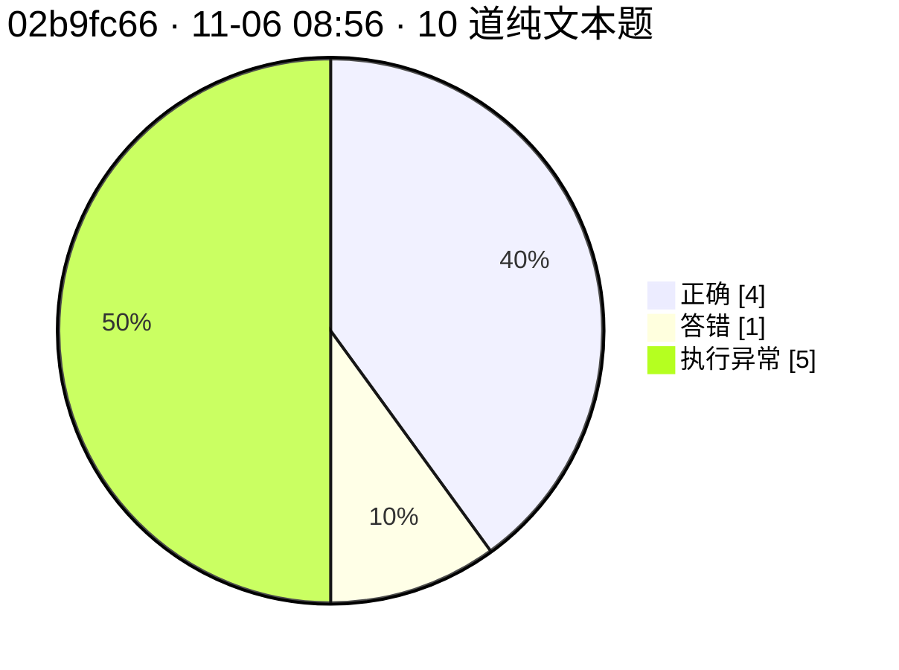

# 07 基准测试：GAIA

[上一章](./06-evaluation.md) 用自建任务比较 Agent 配置。本章使用 [GAIA](https://huggingface.co/papers/2311.12983) 验证通用助手的能力组合：推理、信息检索、多模态理解与工具使用。先跑通网页问答，再扩展附件与计算能力。

**Pydantic AI 执行解题，Pydantic Evals 组织实验，GAIA 的答案匹配规则负责评分。** 本章不需要额外的任务运行框架。

## 7.1 明确被测对象

首轮采用只包含网页搜索与读取的 Pydantic AI Agent：

- `web_search`：通过 `tavily-python` 搜索，返回最多五个来源的标题、URL 和摘要。
- `web_fetch`：使用框架 `WebFetch(native=False, local=True)`，将网页转换成 Markdown；本地执行使工具调用可经过应用的权限与 Hook。
- 输出：结构化的 `final_answer: str`，解释与工具消息单独保存。

这是一条 web-only 基线，不包含完整 coder-cli Harness 的规划、文件操作、shell、记忆和问答交互。两者共用网页工具，但不能把这条基线的成绩报告为完整 coder-cli 的成绩。后续比较 Harness 收益时，应保持模型、任务和工具一致，再逐项引入运行控制。

`WebFetch` 不会执行网页 JavaScript。媒体内容能否被理解仍取决于模型与 provider，不能因为存在 URL 抓取工具就认为所有 GAIA 题都可解。[WebFetch 官方文档](https://pydantic.dev/docs/ai/capabilities/web-fetch/)、[Tavily SDK](https://docs.tavily.com/sdk/python/reference)

## 7.2 把验证集转为 Case

GAIA 的 validation 有公开答案，可在本地评分；test 答案不公开，只能生成预测后按官方渠道提交。数据按三个难度等级组织；目前采用 Parquet，并用相对路径关联附件。下载需要接受数据访问条件。[官方数据卡](https://huggingface.co/datasets/gaia-benchmark/GAIA)

| 数据字段 | 评测用途 |
|---|---|
| `task_id` | `Case.name`，关联预测与日志 |
| `Question` | 输入给 Agent 的问题 |
| `Final answer` | `Case.expected_output`，只给评分器 |
| `Level` | 用例 metadata，按难度分组 |
| `file_name`、`file_path` | 定位本题附件，供筛选和模型输入使用 |
| `Annotator Metadata` | 不传给 Agent，避免泄露解题信息 |

固定题单 `gaia-text-v1` 从 Level 1 选了 10 题，包括 4 道文本推理、5 道文本资料检索、1 道检索后计算。选择时核对题目要求和标注使用的工具，只保留可通过文字完成的题。例如，观看视频辨认鸟类即使没有随题附件，也需要视觉理解，因此排除。题单保存有序 ID 与类别，答案只进入评分器。

取题脚本默认读取指定 revision 的整个 validation。难度、附件状态和数量可以组合筛选。选择纯文本子集时按固定题单顺序取题，其余按 ID 排序。带附件的实验将文本或二进制内容作为模型输入，格式支持取决于模型，加载或调用异常计入报告。

## 7.3 解题与评分分离

执行链路为：

```text
固定版本 validation → Case(question, expected_output)
  → Dataset.evaluate(solve, max_concurrency=1)
  → 新 conversation，Agent 调用 web_search / web_fetch
  → result.output.final_answer
  → GaiaCorrect 比较最终答案与 expected_output
  → 保存逐题结果与汇总
```

评测入口位于 `evaluation/gaia.py`，数据选择与评分规则分别放在同包中的 `gaia_data.py`、`gaia_score.py`。解题函数只接收 Case.inputs，不能接收标准答案。

`conversation_id` 表示会话，`run_id` 表示一次 Agent 运行，沿用 [Pydantic AI Conversation](https://pydantic.dev/docs/ai/api/pydantic-ai/conversation/) 和 [AgentRun](https://pydantic.dev/docs/ai/api/pydantic-ai/run/) 的术语；GAIA 的 `task_id` 仍是题目身份，不能替代这两个标识。

GAIA 使用规范化后的近似精确匹配：数字、按顺序排列的列表、普通字符串分别处理。这里按固定版本的[官方 scorer](https://huggingface.co/spaces/gaia-benchmark/leaderboard/blob/9f133d7/scorer.py) 实现相同规则，不引入 LLM Judge、语义相似度或额外数值容差。用专门的 `final_answer` 字段评分，避免解释文字影响匹配。

Evals 自定义评估器只读取模型输出与标准答案，不能调用模型修改答案或重新解题。接口见[Pydantic Evals 自定义评估器](https://pydantic.dev/docs/ai/evals/evaluators/custom/)。

## 7.4 GAIA 测试集合

先在 GAIA 数据页接受访问条件并配置 Hugging Face 凭据。在 `coder-cli/.env` 配置模型和 Tavily 后，从 `coder-cli` 目录执行实验：

```bash
uv sync --locked --group eval
# 核对 10 道题的 ID，这一步只读数据
uv run --group eval python -m evaluation.gaia_data --subset text
# 运行固定题单，自动记录 commit 与时间
uv run --group eval python -m evaluation.gaia --subset text
```

默认每题限制 180 秒、20 次模型请求和 30 次工具调用。只验证接线时可加 `--limit 1`。省略全部筛选参数将选中 165 道 validation 题，包括 38 道附件题。先用取题脚本核对数量，再用相同参数启动评测。

`GLM-5.3-Flash-Event` 在 `gaia-text-v1` 的 10 道题中答对 **4 题（40%）**，累计耗时 **139.9 秒**。



| 任务类别 | 正确 | 答错 | 执行异常 |
|---|---:|---:|---:|
| 文本推理 | 3 | 1 | 0 |
| 检索后计算 | 1 | 0 | 0 |
| 网页检索 | 0 | 0 | 5 |

5 道网页检索题的轨迹均记录了同一故障：WebFetch 拒绝解析到私网地址的请求，随后重试耗尽。
