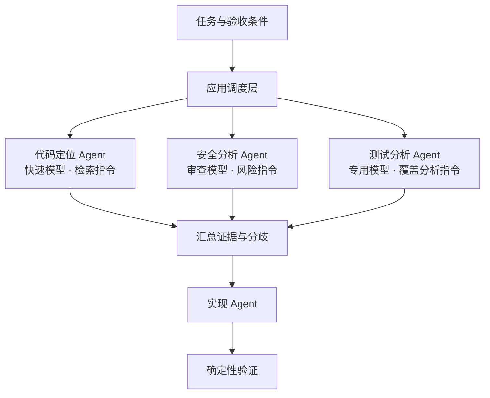
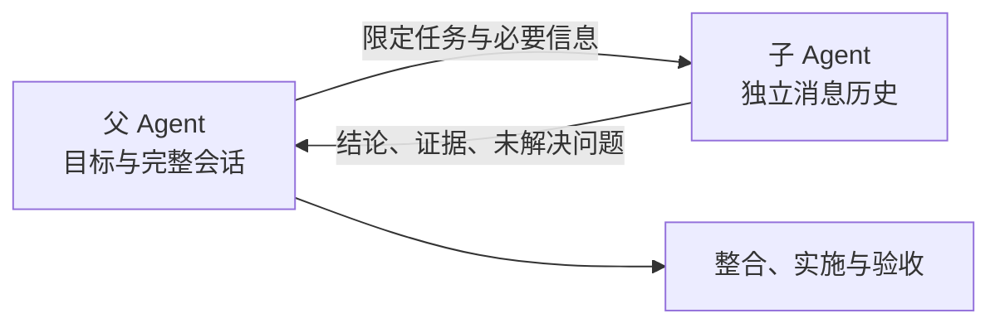

# Multi-Agent 与 Sub-Agent：设计草稿

本章先记录方案，在 [Evaluation](./06-evaluation.md) 与 [Benchmark](./07-benchmark.md) 完成后，按实验结果选择实现。示例展示原生接口，不代表 coder-cli 已启用这些能力；决策模式见 [Harness：决策模式](./05-harness.md#3-决策模式)。

## 1. 区分三个维度

**角色分工、上下级关系、并发执行是三个独立维度。** 多个 Agent 可以串行，也可以并行；可以使用同一模型，也可以使用不同模型。

| 概念 | 核心问题 | 典型结构 |
|---|---|---|
| Multi-Agent | 不同任务交给谁，结果如何交付？ | 多个独立角色，由程序或协调者连接 |
| Sub-Agent | 谁委派任务，结果返回给谁？ | 父 Agent → 子 Agent → 父 Agent |
| 并行执行 | 哪些任务可以同时运行？ | 无依赖任务并发，依赖任务等待结果 |

一个角色的完整配置是：**模型 + 系统指令 + 工具权限 + 输入输出约定 + 预算**。只换模型不等于完成角色设计，只换系统指令也不会形成权限边界。

多 Agent 的收益可能来自专业化、上下文分离和并行；额外开销来自任务交付、重复读取、消息通信和结果整合。父上下文变短，不代表总 token 更少。

## 2. Pydantic AI 的原生支持

| 编排方式 | 原生机制 | 控制权 | 适用条件 |
|---|---|---|---|
| 固定串联、分支、并行 | Python 调用 `Agent.run()` | 应用代码 | 顺序和依赖已知 |
| 专项委派 | Harness `SubAgents` | 父模型决定调用 | 子任务边界清楚，结果可独立交付 |
| 完整交接 | 程序化 hand-off、输出函数 | 应用或输出决定后续角色 | 一个角色结束，另一个继续 |
| 状态图 | `pydantic-graph` | 节点、状态、条件边 | 多阶段分支、回退与终止规则明确 |
| 动态编排 | Harness `DynamicWorkflow` | 模型生成编排脚本 | 任务组合需要运行时决定 |
| 后台子任务 | `SubAgents` + `TaskControl` | 父模型及任务控制机制 | 需要查询、补充信息、问答和取消 |

先用普通 Python；状态转换复杂后再引入 Graph。框架提供运行与调用机制，路由标准、资源所有权、验收规则仍由应用定义。[官方多 Agent 指南](https://pydantic.dev/docs/ai/guides/multi-agent-applications/)

## 3. 平行 Multi-Agent：任务不同，角色不同

### 3.1 任务路由

任务先选择适合的执行者，不一定同时启动多个 Agent。

| 角色 | 模型选择依据 | 专用系统指令 | 工具边界 |
|---|---|---|---|
| 代码定位 | 检索准确率、延迟、成本 | 找定义与调用关系，返回位置和证据 | 只读搜索、读取 |
| 功能实现 | 编码与工具使用能力 | 遵循约束，完成修改与验证 | 文件修改、命令 |
| 变更审查 | 缺陷发现率、误报率 | 对照需求和 diff，报告可证实问题 | 只读代码、验证结果 |
| 架构分析 | 复杂推理与方案权衡 | 比较约束、迁移代价和风险 | 只读项目、资料 |

模型映射由 benchmark 决定，不预设“小模型一定适合搜索”或“最大模型一定更会审查”。先支持明确规则或指定角色；路由复杂后再评估分类模型，避免每个请求都多付一次分类成本。

升级模型应基于任务难度或能力不足；权限拒绝、缺少凭据、环境不可用不通过换模型解决。

### 3.2 并行分工与集中汇总

独立任务同时分析，完成后统一决策。每个 Agent 有自己的输入、上下文和输出，不默认复制完整聊天历史。



这是平行角色编排，不要求父模型通过委派工具发起。汇总也不一定需要模型：先用代码校验结构、去重和检查来源，再交给实现者。存在分歧时回查证据，不用简单多数票替代正确性判断。

以下为最小工程示意；模型与只读工具由应用提供，运行控制省略：

```python
import asyncio
from pydantic import BaseModel
from pydantic_ai import Agent

class Evidence(BaseModel):
    conclusion: str
    sources: list[str]
    uncertainties: list[str]

locator = Agent(
    fast_model,
    instructions="定位相关代码，返回文件位置、证据与不确定点。",
    tools=read_tools,
    output_type=Evidence,
)
reviewer = Agent(
    review_model,
    instructions="分析任务范围内的安全约束，只报告有证据的风险。",
    tools=read_tools,
    output_type=Evidence,
)

async def investigate(code_task, security_task):
    async with asyncio.TaskGroup() as group:
        code = group.create_task(locator.run(code_task))
        security = group.create_task(reviewer.run(security_task))
    return code.result().output, security.result().output
```

这里 `TaskGroup` 在一个分支发生未处理异常时取消其他分支。若业务允许部分结果，应用必须显式规定哪些失败可降级，不能将缺失结果当成分析通过。

### 3.3 平级团队协作

团队成员拥有独立上下文，持续交换证据、领取任务和协调依赖。与一次性并行分工相比，还需要任务状态、消息投递、重复处理防护、恢复和终止机制。

适合需要成员互相质疑、持续交流的工作；不适合紧密依赖、频繁修改同一文件的小任务。不能把几个 `Agent.run()` 并发调用就称为完整团队系统。

## 4. Sub-Agent：限定交付，保留主上下文

父 Agent 将边界清楚的任务交给子 Agent，仅接收必要结果。子任务产生的大量搜索与工具输出保留在自己的历史中。



### 4.1 原生 SubAgents

`SubAgents` 提供 `delegate_task(agent_name, task)`，支持命名角色、模型菜单、子任务预算、超时、调用次数、委派深度和事件。子运行不自动看到父会话，依赖对象会转交；默认转交用量统计，具体预算语义见[原生 SubAgents](https://pydantic.dev/docs/ai/harness/subagents/)。

最小只读调查员示意，模型和工作目录由工厂提供：

```python
from pydantic_ai import Agent, UsageLimits
from pydantic_ai.capabilities import LocalWorkspace
from pydantic_ai_harness.filesystem import FileSystem
from pydantic_ai_harness.subagents import SubAgent, SubAgents

investigator = Agent(
    model,
    name="investigator",
    description="定位代码，返回文件位置、证据与不确定点。",
    capabilities=[FileSystem(read_only=True)],
)
parent = Agent(model, capabilities=[
    LocalWorkspace(workspace),
    SubAgents(agents=[SubAgent(
        investigator,
        read_only=True,
        usage_limits=UsageLimits(request_limit=10),
        timeout_seconds=60,
        max_calls=2,
    )]),
])
```

示例数值需校准。`read_only=True` 限制工作空间操作，仍只能配置可信只读工具；任意 Python 工具可能绕过工作空间接口。独立消息历史也不等于独立进程、文件系统或凭据。

`Coder()` 可提供 self 委派：用同一个 Agent 开启新运行，带上它绑定的能力与工具。对需要最小权限的应用，优先显式定义角色，不直接复制全部能力。

### 4.2 后台与动态编排

`TaskControl` 增加后台委派、任务查询、补充消息、回答子任务问题和取消，并可用 `max_running_tasks` 限制活跃任务。需要持续控制时再接入，不为普通一次性委派预先建立后台系统。

`DynamicWorkflow` 让模型在 Monty 沙箱中生成 Python 编排脚本，实现并行、串联和汇总；`max_agent_calls` 提供子运行次数硬上限，`forward_usage` 等配置控制统计与预算。并发 token 检查仍可能超出阈值，不能等同精确费用上限。[DynamicWorkflow](https://pydantic.dev/docs/ai/harness/dynamic-workflow/)

该能力需要可选依赖 `pydantic-ai-harness[dynamic-workflow]`。编排脚本的沙箱不自动隔离子 Agent 的工具，子运行仍需自己的执行边界。

## 5. Amp 与 Claude 的参考

### 5.1 Amp：稳定角色，按任务配置模型

Amp 将模式定义为模型、推理投入、系统指令与工具的组合；模型可以更新，角色职责保持稳定。辅助工作也可由专用模型承担。[Amp 模型与角色](https://ampcode.com/docs/models-and-subagents)

本次查阅时，内置 Task 子 Agent 与主线程使用相同模型和推理投入；Oracle、Finder、Librarian 插件可配置其他模型。因此“为任务选择模型”包含主模式、专业角色与辅助模型，不表示每个子任务都会自动换模型。[Amp 当前路由](https://ampcode.com/modes#amp-credits)

值得借鉴：把任务路由作为产品能力，以角色的质量、成本和延迟选择模型；不要把某一时点的模型名称固化为架构。

### 5.2 Claude：结果委派与团队协作

Claude Code 的普通委派以专项任务和返回结果为主；Agent Teams 则支持独立成员、共享任务与直接通信，也可配置不同模型和角色指令。官方将 Teams 标为实验能力，并提示协调开销、token 成本及恢复等限制。[Claude Agent Teams](https://code.claude.com/docs/en/agent-teams)

值得借鉴：先明确任务责任与证据交付；只有工作需要成员持续讨论、自主协调时才增加团队机制。角色配置和通信能力不替代权限控制，也不保证总成本下降。

## 6. coder-cli 的接入边界

当前接线显式关闭 `Coder(sub_agents=False)`；以下是后续接入要求，不是已经完成的功能。

| 边界 | 要解决的问题 |
|---|---|
| 工具执行锁 | 父委派调用持锁等待子运行、子运行又等待同一锁会死锁；委派等待不能占住子工具所需的锁 |
| 会话与目录锁 | 子运行不能重新进入顶层发送入口抢父锁；平行顶层任务不能绕过目录互斥 |
| 用户反馈与审批 | 当前交互状态面向一个运行；需明确各运行的问题、批准和取消归属 |
| 权限与工作空间 | 子角色只拿必要工具；新工作空间保留现有受限后端，不能换成无限制后端 |
| 上下文与记忆 | 只传必要任务信息，明确项目记忆是否共享，禁止多个实例并发覆盖文件记忆 |
| 持久化与恢复 | 记录父子关系或编排关系，保留失败与未完成进度；恢复不自动重放未知副作用 |
| 并发与预算 | 活跃任务数、模型请求数、调用次数分别限制；同供应商角色共享原生请求 limiter |
| 结果验收 | 结构化结果保留证据与不确定点；整合者负责验证，不能相信“已完成”标签 |

`conversation_id`、`run_id` 沿用 [Pydantic AI 标识](https://pydantic.dev/docs/ai/api/pydantic-ai/run/)。父子运行使用原生关系；平行独立会话不为方便追踪伪装成父子。不要另造 `turn_id`，也不要用共享聊天历史充当任务队列。

采用结构化交付，先约定内容再选择消息系统：

```text
输入：目标、范围、必要背景、验收条件、预算
输出：结论、证据位置、产物、验证结果、未解决问题
控制：超时、取消、失败处理、允许的后续动作
```

权限判断由应用执行，不接受角色自己声明“只读”。取消需要传播至相关运行并等待清理；模型请求 limiter 不替代文件写入协调。不同 Agent 使用不同模型，也不意味着已完成故障隔离。

## 7. 工程价值：与单 Agent 比较

**专业分工、上下文控制与并行提速是收益来源；拆成多个 Agent 不保证更准或更省 token。** 简单、局部、依赖紧密的任务，单 Agent 通常更合适。

| 维度 | 单 Agent | Sub-Agent 委派 | 平行 Multi-Agent |
|---|---|---|---|
| 速度 | 无交付开销，工作依次推进 | 顺序委派可能更慢；独立子任务才适合并行 | 缩短独立工作的等待时间 |
| 上下文 | 探索细节进入同一历史 | 子历史保留细节，父任务只收必要结果 | 各角色只接收自己的任务信息 |
| Token | 无跨角色交付，长历史可能反复输入 | 增加子运行成本，可能减少父历史后续消耗 | 分发、重复读取、汇总通常增加消耗 |
| 质量 | 全局信息完整，也可能持续误判 | 专项聚焦，交付可能丢失关键条件 | 多角度查漏，需要处理分歧 |
| 工程复杂度 | 最低 | 增加子运行、权限、取消与结果管理 | 再增加并发、依赖和集成管理 |

### 7.1 Sub-Agent：减少主上下文的无效携带

代码定位可能读取几十个文件，实施阶段只需要少量入口、调用关系和证据。探索细节留在子历史，父任务不必在后续每次请求中继续携带。

```text
单 Agent：搜索与阅读细节 → 主历史 → 后续实施反复携带
Sub-Agent：搜索与阅读细节 → 子历史
                              ↓
          父任务只接收：结论、位置、证据、不确定点
```

总 token 是否下降，取决于三个条件：探索输出多、交付结果短而可靠、父任务后续请求多。如果父任务仍需重做调查，或者马上就结束，委派成本可能超过节省。

单 Agent 也能通过按需读取、工具输出限制与历史压缩控制消耗；评测应先建立这些基础能力，避免把它们的缺失误当成必须拆 Agent。

### 7.2 平行 Multi-Agent：减少等待，不减少工作总量

以下只说明耗时关系，不是性能承诺。三个独立分析分别用时 3、4、5 分钟：

```text
顺序耗时 ≈ 3 + 4 + 5 = 12 分钟
并行耗时 ≈ max(3, 4, 5) + 分发、等待与汇总
```

真实任务还受请求限额、资源竞争和重试影响。有依赖的步骤仍须等待；同文件修改会增加冲突与返工。优先并行只读定位、风险分析与测试覆盖分析，写入和验收集中处理。

### 7.3 Token、费用和速度分别计算

```text
总 Token = 调度 + 各 Agent 输入输出 + 汇总 + 返工
总费用   = Σ 各模型按输入、输出、缓存等计费项计算的费用
总耗时   = 依赖链与并行执行耗时 + 排队 + 协调 + 验证
```

- 总 token 增加，仍可能因角色使用更便宜的模型而降低费用。
- 费用增加，仍可能因并行而缩短交付时间。
- 父上下文变小，重复调查仍可能让总 token 增加。
- 多一次审查可能增加当次成本，也可能提前发现缺陷、减少返工。

因此比较**每个验收成功任务的总成本与耗时**，同时保留失败与重做的消耗；不能只比较单次请求价格，也不能只统计父 Agent 用量。当前没有 coder-cli 对照实验，不承诺具体节省或提速比例。

## 8. 评测与实现顺序

| 顺序 | 候选模式 | 要验证的收益 | 主要代价 |
|---|---|---|---|
| 1 | 单 Agent 基线、按任务路由 | 简单任务是否更快、更省且不降质 | 路由错误、升级成本 |
| 2 | 限定工具的只读 Sub-Agent | 父上下文是否更小、定位是否准确 | 重复读取、交付遗漏 |
| 3 | 平行只读分析、集中汇总 | 独立分析的总耗时是否降低 | 重复工作、冲突结论 |
| 4 | 按需独立审查 | 是否发现原流程遗漏的问题 | 误报、额外请求与修复 |
| 5 | 后台控制、动态编排、团队协作 | 持续协调是否产生可测收益 | 状态、通信、恢复复杂度 |

先保留一个项目写入者。需要并行修改时使用独立目录或 worktree，并单独设计产物合并、冲突处理与集成验证；不是取消目录锁。

固定任务、验收标准、模型版本和预算，重复运行。统计端到端成功率、回归、总耗时、总 token／费用、交付错误与取消后的资源清理。多模型路由、角色拆分、并行执行分别做对照，再测试有效组合，避免把模型升级的收益归因于编排。

暂不自建通用调度器、消息总线或自治任务认领系统。优先复用原生 Agent、SubAgents、TaskControl 和并发限制，只有验收与运行边界需要应用补充。
