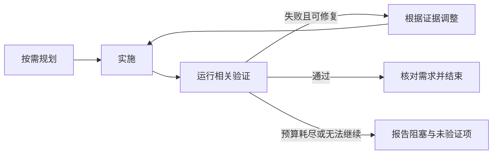

## 1. Ultra Harness

完成 [Evaluation](./06-evaluation.md) 与 [Benchmark](./07-benchmark.md) 后，再增强 Harness。先用相同任务比较成功率、回归、耗时和 token，确认收益后接入；不因多了一次规划或反思就认定能力更强。

## 2. 决策模式

**Planning 管任务，Reflection 管反馈，Thinking 管推理深度。** 三者可以组合，不是互斥模式。

| 能力 | 作用 | Pydantic AI 原生支持 | 需要应用补充 |
|---|---|---|---|
| Planning | 维持多步骤任务的目标与进度 | Harness `Planning`、计划存储 | 触发条件、会话绑定；严格规划阶段的执行限制 |
| Reflection | 根据失败与验收证据修正实现 | 工具结果、校验、`ModelRetry`、输出验证器 | 验收条件、结果记录、修复预算 |
| Chain-of-Thought / Thinking | 给复杂问题更多推理投入 | Core `Thinking`、统一 `thinking` 设置 | 模型适配、投入选择与效果评测 |

### 2.1 Planning：任务计划与执行阶段

长任务容易遗漏步骤，结构化计划将目标变成可更新的清单；简单修改通常不需要。原生 `Planning` 提供步骤、状态及持久化存储，计划通过消息和工具结果保持可见，避免反复改写系统指令破坏缓存。默认计划只保留一次运行，跨轮使用需配置存储。[Pydantic AI Planning](https://pydantic.dev/docs/ai/harness/planning/)

最小接线如下，变量由运行工厂提供：

```python
from pydantic_ai_harness import Planning
from pydantic_ai_harness.planning import SqlitePlanStore

planning = Planning(
    tools=["write_plan"],
    store=SqlitePlanStore(plan_database, session=conversation_id),
)
```

`conversation_id` 沿用 [Pydantic AI 会话标识](https://pydantic.dev/docs/ai/api/pydantic-ai/run/)，不另造计划会话 ID。计划存储也要纳入工具不可修改的运行存储；内部计划工具应明确归类，避免每次更新清单都询问权限。

**任务清单不等于 Plan mode。** `Planning` 不会禁止修改代码，也不保证步骤按顺序执行。Claude Code 的常规规划流程包含研究、提交方案、批准后执行；具体命令行为仍取决于权限配置。[Claude Code Plan mode](https://code.claude.com/docs/en/permission-modes#analyze-before-you-edit-with-plan-mode)

如果需要严格规划阶段，应用还须控制：

```text
规划：读取与研究 → 提交计划 → 等待批准
执行：批准当前计划 → 开放对应工具 → 实施与验证
变更：任务范围或计划实质变化 → 重新确认
```

规划时禁止项目写入及其他有副作用的操作，仅允许受控计划存储更新；不能只加一句“请先规划”。上一章的 `read-only` 会询问写入，不能直接当成严格规划阶段。批准计划也不覆盖工具权限，MCP 启动等前置操作仍需受控。

### 2.2 Reflection：优先形成验证闭环

Pydantic AI 的原生自我纠正包括参数与输出校验失败后的重试，以及工具、输出验证器通过 `ModelRetry` 返回纠正信息；这些机制不自动判断代码是否满足需求。[Reflection and self-correction](https://pydantic.dev/docs/ai/core-concepts/agent/#reflection-and-self-correction)



| 反馈来源 | 用法 |
|---|---|
| 测试、类型检查、命令结果 | 优先使用可核实的证据；按改动范围选择检查 |
| 同模型复查 | 对照需求与 diff 查遗漏，不能代替验证 |
| 独立评审模型 | 有明确评价标准且收益可测时再加入 |

Anthropic 的 evaluator-optimizer 模式强调明确评价标准与可衡量的迭代收益，编码任务可用测试结果反馈。[Building effective agents](https://www.anthropic.com/research/building-effective-agents)

工程上先补齐验收条件、通过／失败／未运行的结果记录，以及修复次数和消耗上限。普通测试失败可直接作为工具结果反馈，不必全部转换成 `ModelRetry`；后者更适合参数或输出不符合约定的情况。

不固定追加“再反思一次”，不让评审只读取最终总结，也不为所有任务增加第二个 Agent。同模型可能重复原来的误判，独立模型则增加请求、上下文和协调成本。

### 2.3 Thinking：使用模型原生推理

CoT 是推理方法，Thinking 是模型侧推理能力。工程产物保留计划、结论和验证证据，不要求模型输出完整思维链，也不把思考文字当作正确性证明。

```python
from pydantic_ai.capabilities import Thinking

thinking = Thinking("medium")  # 作为 capability 接入。
# 或通过运行设置配置：
model_settings = {"thinking": "medium"}
```

Pydantic AI 提供统一接口，实际深度、能否关闭及历史推理内容的处理取决于供应商和模型。[Pydantic AI Thinking](https://pydantic.dev/docs/ai/capabilities/thinking/)

Claude 的 adaptive thinking 可在工具调用之间继续推理，effort 调节投入程度。复杂诊断、算法与长任务可能受益，简单修改则可能增加延迟与 token；应比较结果，而不是默认调到最高。[Claude thinking](https://platform.claude.com/docs/en/about-claude/models/extended-thinking-models)

coder-cli 目前通过 `OpenAIChatModel` 访问模型；兼容接口不代表推理参数也相同。例如原生 `ZaiModel` 负责 GLM 的参数转换与推理内容回传，但当前 GLM 部署是否遵循该协议仍需验证。[Z.AI 适配](https://pydantic.dev/docs/ai/models/zai/)

增强时优先使用原生模型适配和配置，不自定义 `<think>` 解析器；保留框架消息结构，不手工拼接或改写供应商要求回传的推理块。

### 2.4 评测后再增强

先以当前 Harness 为基线，在小修复、多文件功能、重构任务上逐项比较，再测试有效能力的组合：

| 实验 | 要验证的收益 | 同时观察的代价 |
|---|---|---|
| 加任务计划 | 步骤遗漏、任务偏离是否减少 | 计划更新的 token 与工具调用 |
| 加验证反馈约束 | 验收通过与回归情况是否改善 | 检查耗时、修复次数 |
| 调节 Thinking | 困难任务成功率是否提高 | 总耗时、输入／输出与推理 token（接口提供时） |
| 加独立评审 | 是否发现前述流程遗漏的问题 | 额外请求、误报与修复成本 |

固定任务、验收标准、模型版本和预算，保留多次运行结果；比较真实改动与验证证据。计划标记完成、模型声称通过，都不算任务成功。

增强顺序：**最小 Planning → 验证反馈 → 模型 Thinking 适配**。严格 Plan mode 与独立 Reflection Agent 在评测证明有收益后再接入。

## 3. hooks
